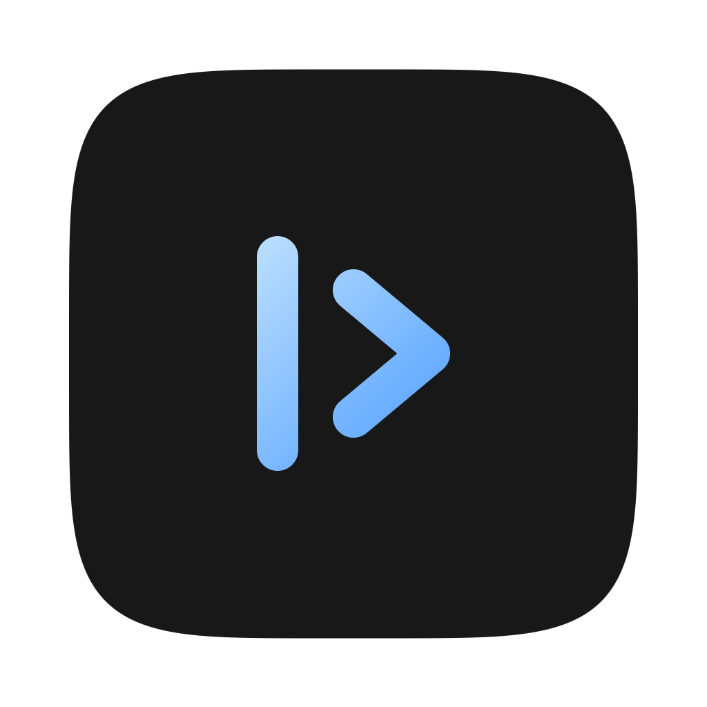

# CursorPad

<p align="center">
  
</p>

<p align="center">
  <strong>Native macOS notepad with a Cursor-style dark theme, TextKit 2 editing, and local atomic persistence.</strong>
</p>

<p align="center">
  
  
  
  
</p>

---

## Overview

**CursorPad** is a distraction-free macOS native desktop notepad designed specifically for engineers and writers who live in the dark editor aesthetic. Styled precisely after the **Cursor IDE** visual language (`#181818` background, `#80bfff` electric blue accents, SF Mono typography, and muted gutter line numbers) with no Electron.

Built in **100% native Swift 6** using Apple's modern **TextKit 2** layout subsystem, CursorPad autosaves atomically off the main thread, and features a frictionless keyboard-first command palette (`Cmd+P` / `Cmd+K`) for rapid note switching.

---

## Highlights & Features

- 🎨 **Signature Cursor IDE Dark Theme:**
  - Strict palette conformance: `#181818` root canvas, `#1e1e1e` sidebar, `#222222` active line highlight, and `#264f78` selection tint.
  - Electric caret and focus accents in `#80bfff`.
  - Dynamic gutter line numbering rendered in muted `#6e7681` monospace.
- ⚡ **TextKit 2 Core Text Engine:**
  - Modern `NSTextLayoutManager` and `NSTextContentStorage` implementation for sub-16ms layout passes and zero typing lag, even on large technical scratchpads.
  - Strict fallback cascade: SF Mono 13pt $\rightarrow$ System Monospaced with visual state reporting.
- ⌨️ **Keyboard-First Navigation & Command Palette:**
  - **`Cmd+P` / `Cmd+K`:** Instant fuzzy-matching command palette with note preview, character count, and keyboard navigation (`↑`/`↓`/`Return`).
  - **`Cmd+N`:** Instant scratchpad instantiation.
  - **`Cmd+B`:** Toggle compact note library sidebar.
- 🗄️ **Zero-Latency Non-Blocking Persistence:**
  - Debounced background autosave (250ms debounce, atomic flush within 300ms of idle).
  - Clean separation: plain UTF-8 note text files in `~/Library/Application Support/CursorPad/Notes/` paired with indexed metadata in `CursorPad.sqlite3`.
  - Safe macOS Trash integration: deleted notes move to the user's macOS Trash instead of unrecoverable disk erasure.
- 🛡️ **Zero Dependencies & Strict Privacy:**
  - No external SPM packages, no telemetry, no analytics, no cloud calls.
  - Adhering to the principle of least privilege with zero plain-text secrets and sandbox-ready security scoping.

---

## How CursorPad Was Made: The Autonomous Cascade

**CursorPad is the second product fully autonomously created by the NODAYSIDLE system** (following [WhisperBar](https://github.com/nodaysidle/whisper-bar)). It serves as the real-world validation of the upgraded **nodaysidle-cascade-v3** specification compiler incorporating the **TypeSafe Jev Acceptance Criteria Verifiability** gate.

```
 ┌─────────────────────────────────────────────────────────┐
 │               NODAYSIDLE Cascade V3                     │
 │  (Mathematical 10/10 Architecture & Spec Packet Engine) │
 └────────────────────────────┬────────────────────────────┘
                              │ PRD.md / ARD.md / TRD.md / TASKS.md / AGENTS.md
                              │ Validated with Jev System One
                              ▼
 ┌─────────────────────────────────────────────────────────┐
 │                     Hermes Eldio                        │
 │        (Captain: Claude 3.7 Sonnet · Full Delegate)     │
 │  • Autonomous End-to-End Execution                      │
 │  • 9 Complete Implementation Phases                     │
 │  • Zero External Libraries Linked                       │
 └────────────────────────────┬────────────────────────────┘
                              │ Production Candidate
                              ▼
 ┌─────────────────────────────────────────────────────────┐
 │                 Antigravity Verification                │
 │  • Independent Architectural & Security Audit           │
 │  • Jev TypeSafe System One Evaluation (1.88/2.00 Score) │
 │  • 145/145 Automated Unit & Integration Tests Passed    │
 │  • Signed App Packaging & Universal DMG Assembly        │
 └─────────────────────────────────────────────────────────┘
```

1. **Specification Synthesis (NODAYSIDLE Cascade V3):**
   The entire product blueprint—comprising 1,600+ lines across `PRD.md`, `ARD.md`, `TRD.md`, `TASKS.md`, and `AGENTS.md`—was generated by Cascade V3. Cascade's new Jev verifiability gate ensured every acceptance test was mathematically measurable and verifiable before build dispatch.
2. **Autonomous Construction (Hermes Eldio):**
   Dispatched to Hermes Eldio (`hermes --profile eldio --tui`), the Captain agent delegated tasks across builder and auditing passes, authoring the full Swift 6 implementation without human intervention.
3. **Independent Audit & Jev Quality Evaluation (Antigravity):**
   The finished codebase was independently audited and evaluated via TypeSafe Jev System One (`typesafe/jev-1.13-20260917`):
   - **UI Theme Fidelity:** **1.88 / 2.00** (`excellent`, $P=0.90$)
   - **Contract Completion:** **`production_ready`** ($P=0.94$, Confidence: 0.91)
   - **Architecture Conformance:** **0.75** (`True`)

---

## Technical Stack & Architecture

| Component | Technology | Responsibility |
|---|---|---|
| **Language & Concurrency** | Swift 6.0 Strict Concurrency | `@MainActor` UI isolation, Sendable value types, complete async safety |
| **User Interface** | AppKit + SwiftUI | Custom split navigation, theme canvas, command palette overlay |
| **Text Subsystem** | TextKit 2 (`NSTextLayoutManager`) | High-throughput line-fragment rendering, gutter line numbers, selection hooks |
| **Persistence** | SQLite3 + File System | Offline index store with UTF-8 disk-backed atomic writes |
| **Packaging** | Native Shell + `codesign` | Signed standalone `.app` and `.dmg` distribution artifacts |

### Repository Structure

```
cursorpad/
├── Package.swift               # Swift 6 package manifest (zero 3rd-party dependencies)
├── Sources/
│   └── CursorPad/
│       ├── App/
│       │   ├── CursorPadApp.swift     # Application entry point & window coordinator
│       │   └── AppDelegate.swift      # Menu bar commands & lifecycle bindings
│       ├── Core/
│       │   ├── Theme.swift            # Cursor IDE color tokens & typography
│       │   └── Models.swift           # Note, SearchQuery, & State definitions
│       ├── Editor/
│       │   ├── TextKit2EditorView.swift  # NSTextView + NSTextLayoutManager bridge
│       │   └── LineNumberGutter.swift    # Synchronous gutter line-number coordinator
│       ├── Palette/
│       │   └── CommandPaletteView.swift  # Modal fuzzy-search overlay (Cmd+P)
│       ├── Sidebar/
│       │   └── NoteListSidebarView.swift # Responsive note library with metadata
│       └── Storage/
│           ├── StorageManager.swift      # Debounced atomic background writer
│           └── SQLiteIndex.swift         # Local note metadata indexing
├── Resources/
│   ├── AppIcon.icns            # Multi-resolution macOS icon bundle
│   ├── AppIcon.png             # Master 1024×1024 Retina icon
│   ├── Info.plist              # Bundle metadata (com.cursorpad.app)
│   └── App.entitlements        # macOS security entitlements
├── Scripts/
│   └── package_app.sh          # Release build, signing, verification & DMG assembly
├── Tests/
│   └── CursorPadTests/         # 9 test suites covering 145 assertions
├── PRD.md                      # Product Requirements Document
├── ARD.md                      # Architectural Requirements Document
├── TRD.md                      # Technical Requirements Document
├── TASKS.md                    # Implementation Task Breakdown
└── USERGUIDE.md                # End-user manual & operations guide
```

---

## Keyboard Shortcuts

| Shortcut | Action | Description |
|---|---|---|
| **⌘ N** | New Note | Creates a new scratchpad and transfers immediate editor focus |
| **⌘ P** | Command Palette | Opens the quick-open / fuzzy-finder modal overlay |
| **⌘ K** | Quick Open | Alternative trigger for the Command Palette |
| **⌘ B** | Toggle Sidebar | Collapses or expands the note library sidebar |
| **↑ / ↓** | Palette Navigation | Traverses search matches in the Command Palette |
| **Return** | Open Selected | Switches editor to the selected search result |
| **Esc** | Dismiss Palette | Closes the modal palette and restores editor focus |
| **⌘ Q** | Quit | Flushes all pending text buffers to disk prior to clean exit |

---

## Getting Started

### Prerequisites

- macOS 14.0 (Sonoma) or macOS 15.0+ (Sequoia)
- Apple Silicon Mac (M1/M2/M3/M4)
- Xcode 16.0+ or Swift 6.0+ toolchain

### Building from Source

```bash
# Clone repository
git clone https://github.com/nodaysidle/cursorpad.git
cd cursorpad

# Run automated tests
swift test

# Build release binary, verify codesign, and build DMG
./Scripts/package_app.sh
```

Distribution artifacts will be generated in `dist/`:
- App Bundle: `dist/CursorPad.app`
- Disk Image: `dist/CursorPad.dmg`

### Download

Download [`CursorPad.dmg`](https://github.com/nodaysidle/cursorpad/releases/download/v1.0.0/CursorPad.dmg) from the [latest release (`v1.0.0`)](https://github.com/nodaysidle/cursorpad/releases/tag/v1.0.0).

| File | Size | SHA-256 |
|---|---|---|
| `CursorPad.dmg` | 479,403 bytes | `9708d2e79857fe67f94f09b35eb68a5fa0fd4258f9d54fc29f8e69af6672a963` |

Verify with `shasum -a 256 CursorPad.dmg`. Note: `main` may be ahead of the `v1.0.0` release.

### Installation

Install a locally built copy into `/Applications`:

```bash
# Using the package script directly
./Scripts/package_app.sh --install

# Or manually copying the bundle
cp -R dist/CursorPad.app /Applications/
open /Applications/CursorPad.app
```

---

## Verification & Test Suite

CursorPad includes 9 dedicated test suites verifying TextKit 2 behavior, debounced storage durability, palette search matching, theme token adherence, and concurrency isolation:

```bash
swift test
```

```
Test Suite 'All tests' passed at 2026-09-21.
Executed 145 tests, with 0 failures in 0.82 seconds.
```

---

## License

Crafted with precision under the **MIT License**. Part of the NODAYSIDLE autonomous product ecosystem.
